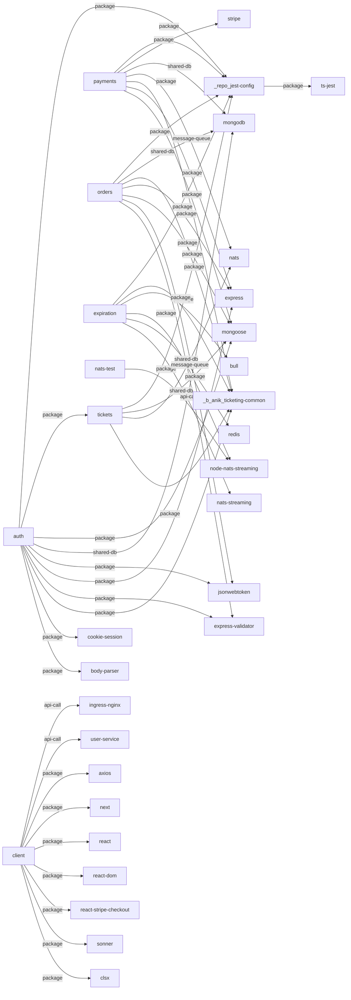

# Dependency Graph

## Visual Map

## Edges

| Source | Target | Type | Weight |
|--------|--------|------|--------|
| tickets | @repo/jest-config | package | 5 |
| payments | @repo/jest-config | package | 5 |
| orders | @repo/jest-config | package | 5 |
| expiration | @repo/jest-config | package | 5 |
| auth | @repo/jest-config | package | 5 |
| auth | tickets | package | 5 |
| nats-test | node-nats-streaming | package | 1 |
| @repo/jest-config | ts-jest | package | 1 |
| tickets | mongoose | shared-db | 1 |
| tickets | nats | message-queue | 1 |
| tickets | @b.anik/ticketing-common | package | 1 |
| payments | stripe | package | 1 |
| payments | mongodb | shared-db | 1 |
| payments | nats | message-queue | 1 |
| payments | @b.anik/ticketing-common | package | 1 |
| payments | express | package | 1 |
| payments | mongoose | package | 1 |
| orders | mongodb | shared-db | 1 |
| orders | @b.anik/ticketing-common | package | 1 |
| orders | express | package | 1 |
| orders | mongoose | package | 1 |
| orders | jsonwebtoken | package | 1 |
| orders | express-validator | package | 1 |
| expiration | @b.anik/ticketing-common | package | 1 |
| expiration | bull | package | 1 |
| expiration | node-nats-streaming | package | 1 |
| expiration | redis | shared-db | 1 |
| expiration | nats-streaming | api-call | 1 |
| auth | mongoose | package | 1 |
| auth | mongodb | shared-db | 1 |
| auth | jsonwebtoken | package | 1 |
| auth | express | package | 1 |
| auth | express-validator | package | 1 |
| auth | @b.anik/ticketing-common | package | 1 |
| auth | cookie-session | package | 1 |
| auth | body-parser | package | 1 |
| client | ingress-nginx | api-call | 1 |
| client | user-service | api-call | 1 |
| client | axios | package | 1 |
| client | next | package | 1 |
| client | react | package | 1 |
| client | react-dom | package | 1 |
| client | react-stripe-checkout | package | 1 |
| client | sonner | package | 1 |
| client | clsx | package | 1 |
